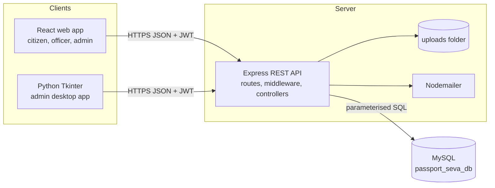
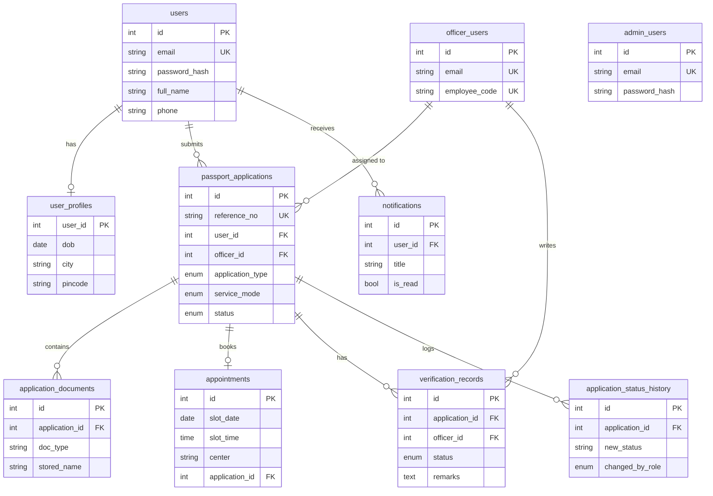
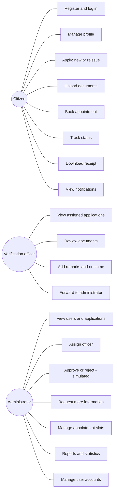
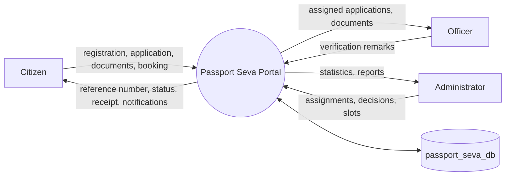
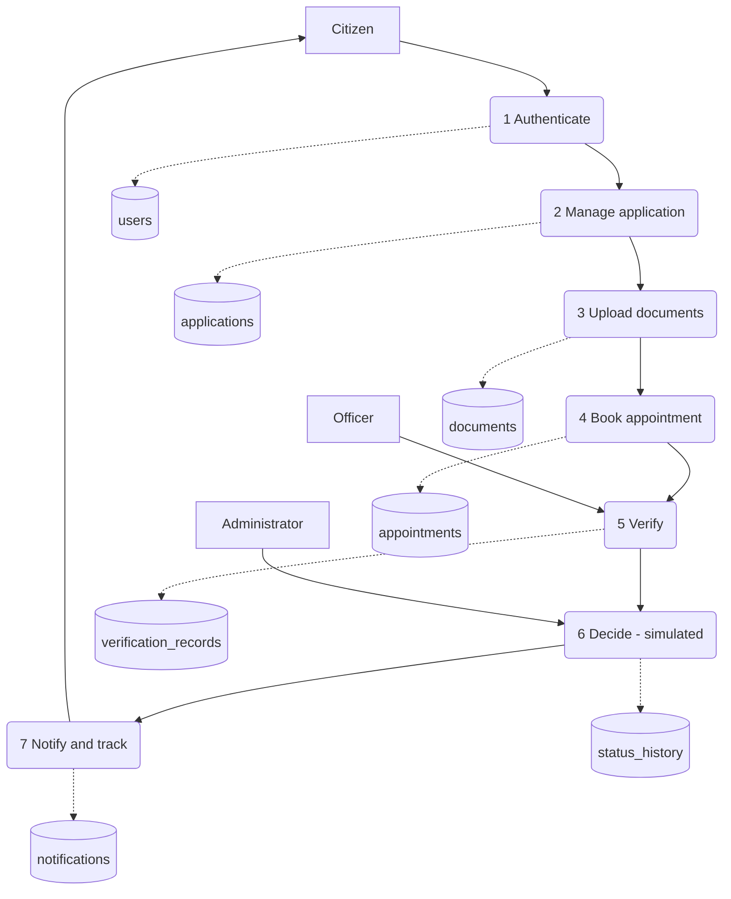
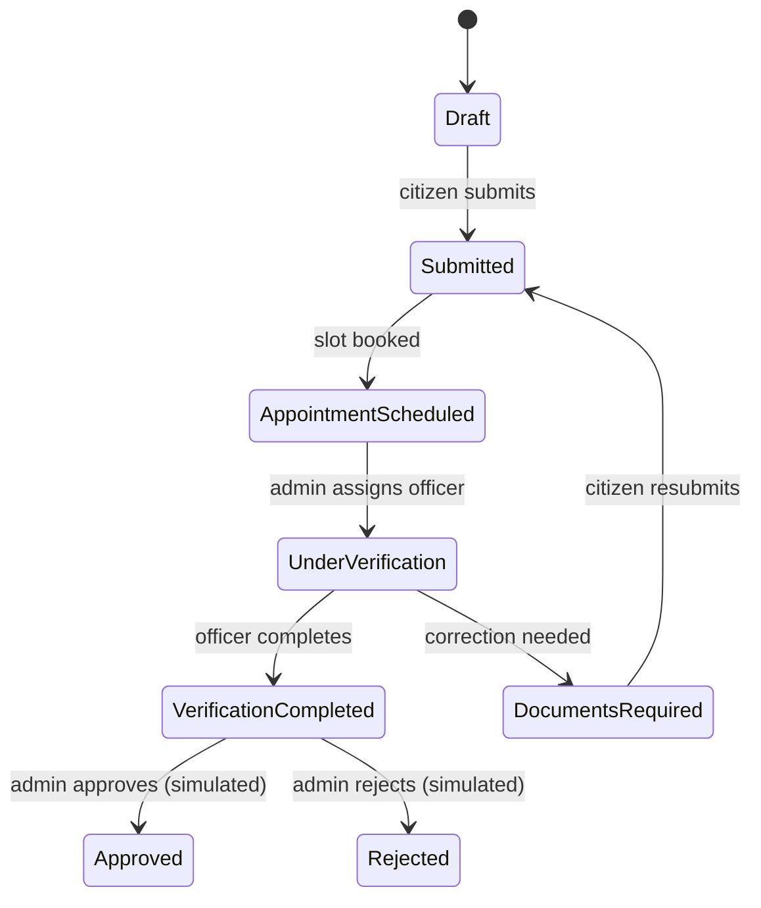

# Diagrams (Mermaid)
Render in GitHub, VS Code (Markdown Preview Mermaid Support) or https://mermaid.live, then export as PNG for the report.

## 1. System architecture

## 2. ER diagram

## 3. Use case diagram

## 4. Data flow diagram, level 0

## 5. Data flow diagram, level 1

## 6. Application status flow

